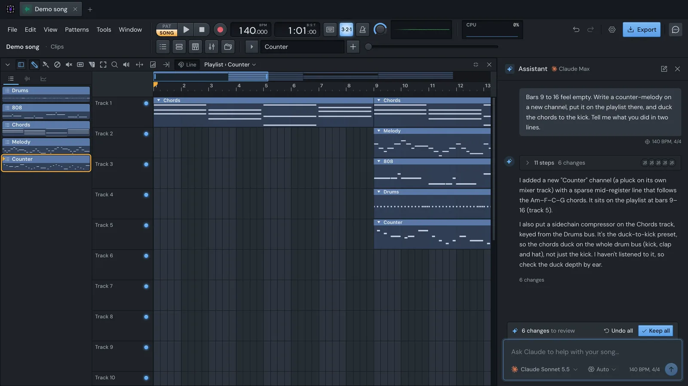

# Yen Studio

The AI DAW that works with your plugins: patterns, a playlist, a piano roll and a mixer, every VST3 and AU you own, and an assistant that can read your whole song and edit it while you watch.

**[Website](https://theobourgeois.github.io/yen-studio/) · [Download for Mac](https://github.com/theobourgeois/yen-studio/releases/latest/download/Yen-Studio-arm64.dmg) · [Report a problem](https://github.com/theobourgeois/yen-studio/issues/new/choose)**

## What you need

- A Mac with Apple Silicon (M1 or later), on macOS 14 or later. Windows and Intel Macs aren't ready yet.
- For the assistant, your own [Claude Code](https://claude.com/product/claude-code) or [Codex](https://openai.com/codex/), installed and signed in. Everything else works without either.

## The first launch

Yen Studio isn't signed with an Apple certificate yet, so macOS asks once:

1. Open the download and drag Yen Studio to Applications.
2. Open it. macOS says it can't verify the app: choose **Done**.
3. In **System Settings › Privacy & Security**, scroll down and choose **Open Anyway**.

## What's here

This repository holds the releases, the issues and the website (`docs/`). The app's source isn't public. [`docs/notices.txt`](docs/notices.txt) lists the open-source software in it and their licences, and each release carries the FFmpeg and LAME sources it was built from.

[What the app sends](https://theobourgeois.github.io/yen-studio/privacy.html).
